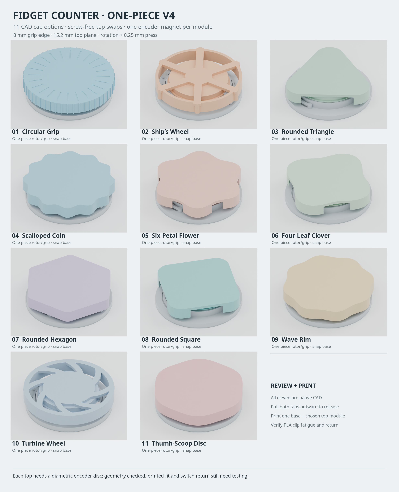
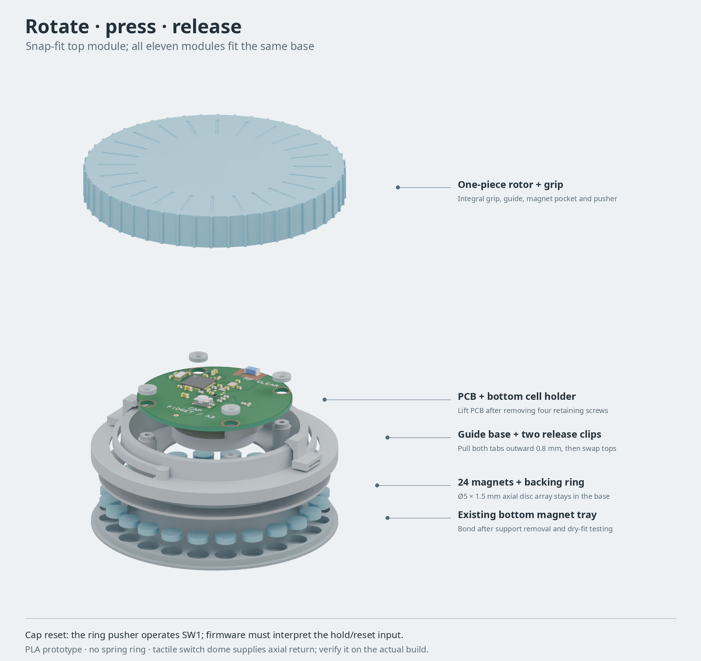

# MagSafe BLE Fidget Counter — one-piece V4 / release 1.0.9

Eleven interchangeable one-piece caps fit the same PLA snap-release base and bottom attachment-magnet tray. The grip edge is 8 mm deep and the overall height remains 15.2 mm. Each top includes its rotor sleeve, retention flange, annular button pusher, protective underplate and encoder-magnet pocket. Pull both opposed base tabs outward to remove the top; no cap-mount screws or separate return spring are required. The tactile switch dome supplies press return.





## Circuit and cap selection

The circular cap is the default 3D preview. Change `CAP_STYLE` near the top of `index.circuit.tsx` to one of the eleven values exported by `CAP_STYLE_OPTIONS` in `enclosure.tsx`. They are circular, ships_wheel, rounded_triangle, scalloped_coin, petal_flower, four_leaf_clover, rounded_hexagon, rounded_square, wave_rim, turbine_wheel and thumb_scoop.

```sh
bun install --frozen-lockfile
bun run typecheck
bun run build:source
bun run check:enclosure
```

After validating a changed source, copy `dist/index/circuit.json` to `published.circuit.json`, run `bun run build`, and then `bun run build:cloud:prepare` to refresh the registry preview. The saved snapshot preserves the checked routed board and assembly. The PCB retains all supplier imports, 0.30 mm via drills and 0.55 mm lands. SW1 is at (0, −5) mm with the Hall sensor centered. There are 30 fitted component models and eight mechanical models in each selected assembly.

The registry cloud worker runs `bun cloud-build.mjs`. It verifies hashes of the circuit source, supplier imports and enclosure assets, checks the saved circuit for error records, and restores the checked PCB, schematic and GLB outputs to `dist/published`. It needs no dependency installation, network model downloads or mesh regeneration. A source change without refreshed artifacts fails explicitly. This avoids the previous cloud `bun run build` command, which stalled until the worker's 30-minute timeout; local source compilation and design checks are still required before preparing a changed preview.

## Cell access and assembly

Release the top, remove the four PCB retaining screws, lift and flip the board with its soldered CR2032 holder, then replace the cell. Every interchangeable top needs its own diametrically magnetized Ø5 × 1.5 mm encoder magnet. The bottom tray retains 24 attachment-magnet pockets.

See MECHANICAL.md and mechanical/MECHANICAL_BOM.csv for assembly instructions. mechanical/Print_STL contains the fourteen checked print parts: eleven complete top modules plus the shared base, tray and retainer. Editable CadQuery sources, parameters and validation are included; use mechanical/requirements.txt to regenerate STEP and STL exports. The CAD audits retain design revision 1.0.7 as their provenance; this registry publication is 1.0.9.

The PCB targets double-sided Standard PCBA and ENIG with the existing TMAG3001 sensor. This is a circuit and CAD prototype. PLA snap fatigue, fit, edge pressing, switch return, magnetic sensing and the assembly order require physical validation. Firmware is not included. Fabrication exports are not part of this registry publication.
