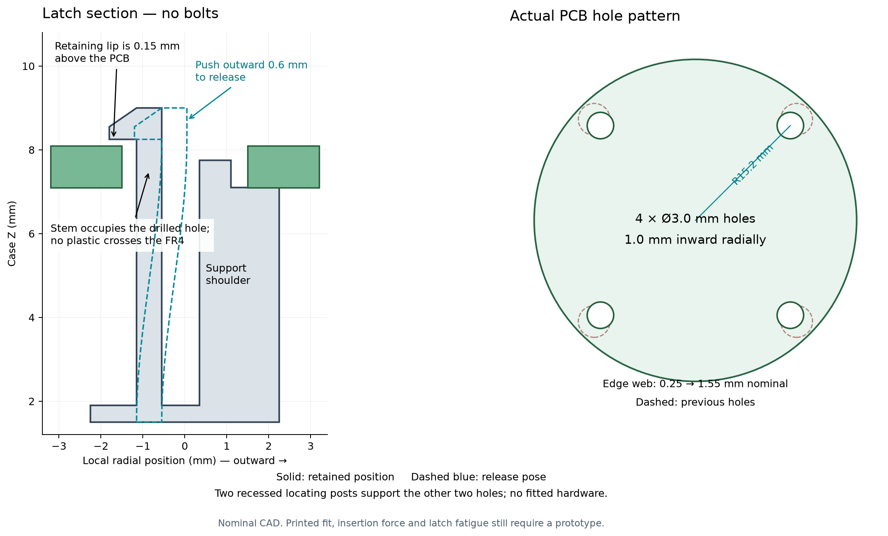

# MagSafe BLE Fidget Counter — JST-SH release 1.0.18

Release 1.0.18 replaces the programming test-pad interface with a fitted five-pin, side-entry JST-SH connector. The existing enclosure and thirty original fitted components are retained.

Eleven interchangeable one-piece caps fit the revised snap-release base and bottom attachment-magnet tray. The PCB presses onto two revised snap latches and two recessed locating posts. Its four Ø3.0 mm mounting holes now sit on a 15.2 mm radius, 1 mm inward from the earlier pattern. The nominal edge web increases from 0.25 to 1.55 mm. Both the cap and PCB retention are screw-free. The grip edge is 8 mm deep and overall height remains 15.2 mm. Each top includes its rotor sleeve, retention flange, annular button pusher, protective underplate and encoder-magnet pocket. Pull both cap-release tabs outward to remove the top. The tactile switch dome supplies press return.



## Circuit and cap selection

The circular cap is the default 3D preview. Change `CAP_STYLE` near the top of `index.circuit.tsx` to one of the eleven values exported by `CAP_STYLE_OPTIONS` in `enclosure.tsx`. They are circular, ships_wheel, rounded_triangle, scalloped_coin, petal_flower, four_leaf_clover, rounded_hexagon, rounded_square, wave_rim, turbine_wheel and thumb_scoop.

```sh
bun install --frozen-lockfile
bun run typecheck
bun run build:source
python validation/check-pcb-mounts.py
python validation/check-jst-fit.py
bun run check:programming
bun run check:assembly
```

JST validation results are recorded in [validation/jst-check-summary.json](https://github.com/rushabhcodes/fidget-counter/blob/main/validation/jst-check-summary.json), with release hashes in [validation/publication-source-audit.json](https://github.com/rushabhcodes/fidget-counter/blob/main/validation/publication-source-audit.json).

Run the Python mount check in an environment with `mechanical/requirements.txt` installed. It checks the STEP base against the native PCB drill pattern and verifies that both exported GLB PCB faces contain the correct holes.

After validating a changed source, copy `dist/index/circuit.json` to `published.circuit.json`, run `bun run build`, and then `bun run build:cloud:prepare` to refresh the registry preview. The saved snapshot preserves the checked routed board and assembly. The PCB retains all supplier imports, 0.30 mm via drills and 0.55 mm lands. SW1 is at (0, −5) mm with the Hall sensor centered. There are 31 fitted component models (the original 30 plus J_DEBUG) and eight mechanical models in each selected assembly.

The registry uses its bundled tscircuit CLI to run `bun cloud-build.mjs` after the CI dependency bootstrap. `alwaysUseLatestTscircuitOnCloud` is enabled so the worker does not launch the pinned compiler through `bunx`, which can stall until the 30-minute timeout. The local compiler remains pinned to `tscircuit@0.0.2748` in `dependencies`; the cloud CLI skips installing that entry. The restore script verifies hashes of the circuit source, dependencies, supplier imports and distributed enclosure assets, checks the saved circuit for error records, and restores the checked PCB, schematic and GLB outputs to `dist/published`. It does not compile the design or download models. A source change without refreshed artifacts fails explicitly; local source compilation and design checks are still required before preparing a changed preview.

Cloud setup rewrites the compiler dependency, release version and lockfile. Manifest format 2 verifies the remaining package settings and component dependency versions independently of those rewrites, and checks the original lockfile during local runs. Run `bun validation/check-cloud-build.mjs` to test both cloud bootstrap formats, stale-source rejection and artifact integrity. See [the cloud retry audit](https://github.com/rushabhcodes/fidget-counter/blob/main/validation/cloud-build-retry.json) for the 1.0.15 build investigation.

The original 1.0.6 files are preserved in [a legacy ZIP](https://github.com/rushabhcodes/fidget-counter/blob/main/.archive-v1.0.6.zip), which TSCI's GitHub importer excludes. You can also [browse the original files in Git history](https://github.com/rushabhcodes/fidget-counter/tree/2b77ad766bdc5dd5649cf8cec29f7280d64741d3/archive/v1.0.6). Current print and STEP exports travel in the checked `cloud-assets/cad-inputs-*.json.gz.b64` archives and are unpacked and hash-checked inside the build container. Existing local CAD files are checked before reuse. The original [STL](https://github.com/rushabhcodes/fidget-counter/tree/main/mechanical/Print_STL) and [STEP](https://github.com/rushabhcodes/fidget-counter/tree/main/mechanical/STEP_Parts) files remain available on GitHub, and the circuit source and supplier models remain directly available in TSCI.

## Cell access and assembly

Release the top, press both diagonal PCB latch tips outward 0.6 mm toward their hole centers, then lift and flip the board with its soldered CR2032 holder to replace the cell. Press the board back onto the support shoulders until both hooks engage. Every interchangeable top needs its own diametrically magnetized Ø5 × 1.5 mm encoder magnet and a 0.2 mm nonmagnetic spacer. The bottom tray retains 24 attachment-magnet pockets.

See [MECHANICAL.md](https://github.com/rushabhcodes/fidget-counter/blob/main/MECHANICAL.md) and [the mechanical BOM](https://github.com/rushabhcodes/fidget-counter/blob/main/mechanical/MECHANICAL_BOM.csv) for assembly instructions. `mechanical/Print_STL` contains thirteen print parts: eleven complete top modules plus the shared base and tray. Use the revised PCB and base together for snap retention. The new locators stay inside the drilled holes, and the retaining lips sit 0.15 mm above the PCB. There are no bolts or screws. Editable CadQuery sources, parameters and validation are included; use `mechanical/requirements.txt` to regenerate STEP and STL exports. Release 1.0.15 includes the revised PCB and screw-free base together.

The programming interface is a fitted top-side **five-pin, side-entry JST-SH SM05B-SRSS-TB(LF)(SN)** at (0, −13.3) mm, using `StandardJstSwdResetSide` from `@tsci/tscircuit.standard-jst-programmer@0.8.0`. Its seven solder lands replace the bare TC2030 contacts and three alignment holes. Use a straight-through five-way JST-SH cable with **SHR-05V-S-B** housings to programmer **J3 / 5PIN**. **Select 3V3 and remove the CR2032 before connecting programmer power**; pin 1 follows the voltage selector. Lift the PCB for side-entry cable access, then disconnect the cable before reassembly. The supplier model clears every cap throughout rotation and pressing by about 0.74 mm nominal; the conservative courtyard envelope leaves 0.73 mm. See [PROGRAMMING.md](https://github.com/rushabhcodes/fidget-counter/blob/main/PROGRAMMING.md), [the connector fit audit](https://github.com/rushabhcodes/fidget-counter/blob/main/validation/jst-connector-clearance.json) and [ASSEMBLY_REVIEW.md](https://github.com/rushabhcodes/fidget-counter/blob/main/ASSEMBLY_REVIEW.md).

The PCB targets double-sided Standard PCBA and ENIG with the existing TMAG3001 sensor. This is a circuit and CAD prototype. PLA snap fatigue, fit, edge pressing, switch return, magnetic sensing and the assembly order require physical validation. Firmware is not included. Fabrication exports are not part of this registry publication.
