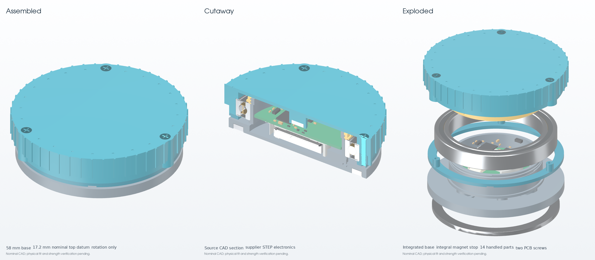

# MagSafe BLE fidget counter

A rotation-only fidget counter with an nRF52810 MCU, TMAG3001A2 angle sensor, CR2450 cell and hollow rotating cap. **One complete turn in either direction counts as one fidget.** Backtracking cancels an unfinished turn.

**1.0.30 corrects the DEC2/DEC3 bypass network and C3 RF ground return from1.0.29. Use the current fabrication bundle.** The [review resolution](validation/AI_REVIEW_RESOLUTION.md) records the fixes and the RF/printed-retention tests still required before production.

The current RevC pilot uses **two printed parts, two PCB screws and nine handled parts**, excluding adhesive/tools. It uses a6808-ZZ/61808-2Z bearing,40×52×7mm. The base isØ58mm, maximum capØ61.6mm and height16.4mm above the phone-contact face. There is no cap button, spring or top screw. The cap has a1.3mm nominal deck and1.2mm local encoder roof, with0.78mm conservative clearance above the programming connector. See the [compact-cap review](mechanical/COMPACT_CAP_REVIEW.md).

## Build, program and assemble

1. [Print the fit coupons and parts](mechanical/printing/PRINTING.md). One unit needs Stationary_Base and one Cap; the other ten cap styles are alternatives.
2. [Build/download the firmware](firmware/README.md), then [program the PCBA](PROGRAMMING.md) before fitting the cell or closing the enclosure.
3. Follow the [step-by-step assembly guide](ASSEMBLY.md), including final count, power-cycle and retention tests.



Firmware source, a custom RevC board definition, logic tests, BLE reader/reset client and a CI build workflow are included. Use a flashable artifact only from a successful Firmware run for the intended commit. The image includes the BLE controller; no separate SoftDevice or bootloader is needed. Physical hardware bring-up remains required.

## What to buy

Quantities are per device with one cap, except shared consumables/tools. Buy the specified dimensions. The PCBA quote must include all27 FIT components, including the soldered battery holder and JST programming header; the loose cell is purchased separately. Supplier listings are examples, not reserved stock or qualified substitutes.

| Item | Quantity | Required specification | Supplier links and fit notes |
| --- | ---: | --- | --- |
| Custom assembled PCB | 1 | RevC Ø36.5 × 1.0 mm PCB with the 27 fitted components in [BOM.csv](BOM.csv) | [JLCPCB assembly service](https://jlcpcb.com/pcb-assembly). This is a custom fabrication/assembly quote, not a stock product. If all **FIT** rows are assembled, BT1's battery holder, J_DEBUG and the other electronics are already included; do not buy those again as loose mechanical parts. |
| Thin-section bearing | 1 | **6808-ZZ / 61808-2Z, 40 × 52 × 7 mm**, chrome steel, two metal shields | [India: HMS](https://www.hmsbearings.co.in/68-series-deep-groove-ball-bearing.html) · [India: BM3/Moglix](https://www.moglix.com/bm3-6808-zz-chrome-steel-deep-groove-ball-bearing-40x52x7-mm/mp/msn8klp8p8yr5v) · [India: NTN/Bearing House](https://bearinghouse.in/shop/ntn-6808zz-deep-groove-ball-bearings/) · [US: JSB](https://jsbgreatbearings.com/product/6808-zz-two-side-metal-shields-bearing-6808-rs-ball-bearings-6808-rs/). See the price/stock comparison below. Supplier drawing and samples must establish race contact, fit, drag and play; 2RS variants require their own drag evaluation. |
| MagSafe magnetic ring assembly | 1 | Current seat: **N52, OD54 × ID45.8 × 1.9 mm**, complete magnetic array with working face toward the phone | [Default reference: MagnetPrint Hub kit](https://magnetprinthub.com/products/magsafe-magnet-kit). [India alternative: Magneticks](https://www.magneticks.in/magsafe-magnetic-ring-13003978.html) lists a **1.0 mm** ring and requires a changed seat depth; it is not the current 1.9 mm part. See [ring sourcing](mechanical/MAGSAFE_RING_SOURCING.md). |
| Encoder magnet | 1 per cap | **Ø5 × 1.5 mm, diametrically magnetized neodymium disc** | [BUYNEOMAGNETS exact-size diametric N38 example, 50-pack](https://www.buyneomagnets.com/p/5mm-x-1-5mm-diametrically-magnetized-neodymium-disc-magnet-n38-rare-earth-diametric-magnets-50-pack/). Size/pole-direction match the reference; magnetic grade and Hall performance still need sample testing. India delivery is unverified. Ordinary axially magnetized discs are not equivalent. |
| PCB screws | 2 | **M2 × 4 mm nylon**, head Ø3.8 mm maximum and height 1.3 mm maximum | [Vital Parts DIN 85, SPH85-M2-4-NY-N](https://www.vital-parts.co.uk/slotted-pan-head-nylon-screws-din-85/42809-sph85-m2-4-ny-n). This example is slotted; use a matching driver. UK supplier example; local equivalents must fit the same head envelope. No metal washer is specified. |
| Battery for current RevC PCB | 1 | **CR2450, 3 V primary lithium, 24.5 × 5 mm**, loose cell without solder tabs | [Panasonic India](https://www.panasonic.com/in/consumer/battery/specialty-batteries/lithium-coin/cr-2450-5be.html) · [India retailer example](https://rajivelectronics.com/product/panasonic-cr2450-3v-lithium-coin-cell-battery/). Insert after PCB reflow. The loose cell is separate from BT1; rechargeable LIR2450 is not a substitute. |
| Magnet adhesive | Small amount; shared pack | Compatible two-part adhesive for PETG and the magnet coating; ring bondline nominal 0.10 mm, encoder sidewall bond only | [RS India: LOCTITE EA 3430 clear epoxy example](https://in.rsdelivers.com/product/loctite/loctite-ea-3430-dc24ml/loctite-loctite-ea-3430-adhesive/2442021). **Coupon-test candidate**, not a qualified PETG bond specification. Check cure, adhesion and retention before choosing a batch adhesive. |
| PETG filament or printing service | As needed | PETG; the provisional print profile assumes a 0.4 mm nozzle and 1.75 mm filament | [Prusament PETG example](https://www.prusa3d.com/product/prusament-petg-jet-black-1kg/). Quantity depends on cap style, supports and batch size. Print the two product parts from the [manifest](mechanical/print-ready-manifest.json); filament is unnecessary if a print service supplies the material. |


The ring dimensions are supplier-specific. Confirm sample dimensions, working-face polarity and coating before buying a batch. The encoder disc must be diametrically magnetized. The standard6808 family has India and US sourcing examples above; qualify a primary and backup bearing for dimensions, race contact, drag and play.

### Shared programming equipment

| Item | Quantity for the bench | Link and requirement |
| --- | ---: | --- |
| Five-way JST-SH programming cable | 1 | [JST A05SR05SR30K152B, DigiKey India](https://www.digikey.in/en/products/detail/jst-sales-america-inc/A05SR05SR30K152B/6708507). Use the **B** candidate and verify continuity **1→1 through 5→5** before powering; the A variant is listed as reversed. |
| Compatible SWD programmer and adapter | 1 setup | [Standard JST programmer v0.8.0 design](https://tscircuit--standard-jst-programmer-v0-8-0.tscircuit.app/#file=circuits%2Fprogrammer.circuit.tsx), which must itself be assembled/flashed, or a commercial [SEGGER J-Link BASE](https://www.segger.com/products/debug-probes/j-link/models/j-link-base/) with the adapter and target-power arrangement in [PROGRAMMING.md](PROGRAMMING.md). These are alternative setups, not two required purchases. |


Select3V3 and remove the CR2450 before powered programming. J_DEBUG pins are1=VBAT/VOUT,2=SWDIO,3=GND,4=SWCLK,5=nRESET. A generic five-pin cable may use another assignment. The linked programmer's5V setting must never be used.

## Files for the pilot

[Print pilot ZIP](https://github.com/rushabhcodes/fidget-counter/blob/codex/bearing-supported-enclosure/manufacturing/fidget-counter-print-pilot-1.0.30.zip) · [Fabrication ZIP](https://github.com/rushabhcodes/fidget-counter/blob/codex/bearing-supported-enclosure/manufacturing/fidget-counter-fabrication-1.0.30.zip) · [Package contents](manufacturing/README.md)

These versioned ZIPs contain the checked1.0.30 hardware files. Get the current assembly/programming instructions and firmware separately from this branch. Use the fabrication ZIP's BOM/CPL/Gerbers for the PCBA quote; its verified supplier rotations and paste/mask preparation matter.

Editable CAD, current STL/STEP/GLB exports and the [print manifest](mechanical/print-ready-manifest.json) are retained. [Mechanical details](MECHANICAL.md), [mechanical BOM](mechanical/MECHANICAL_BOM.csv), [pilot review](mechanical/MANUFACTURING_REVIEW.md) and [PCB review](validation/FABRICATION_REVIEW.md) give the engineering evidence.

## Verification and limits

The hardware has passed its digital circuit, routing, CAD/mesh, clearance and actual PrusaSlicer checks. It remains a **fit-test pilot**. The bearing push-fit has no positive axial lock; nominal0.05mm interference does not establish printed retention. Print one circular prototype and its coupons before a10–50-unit batch.

Physical checks still include pull-off force, PETG creep, screw retention, adhesive strength, loaded battery-holder contacts, magnetic count accuracy with bearing/ring/phone, RF performance and current/runtime. The6.8nH L2 is±5% and final-enclosure matching must be measured. Firmware build success is separate from flashing and hardware acceptance. See [the assembly checklist](ASSEMBLY.md#7-check-the-finished-device).

## Rebuild the hardware

Use pinned tscircuit0.0.3060, the Bun lockfile, mechanical Python requirements, KiCad9, Gerbonara and PrusaSlicer2.8.1. Firmware has its own [build sequence](firmware/README.md#build-on-linux).

```sh
bun install --frozen-lockfile
bun run typecheck
bun test
bun run build:source
cp dist/index/circuit.json published.circuit.json
bun validation/check-fresh-routing.mjs
python validation/check-nordic-rf.py
bun validation/check-source-snapshot.mjs
bun validation/run-fabrication-review.mjs
python validation/check-gerber-parity.py
bun run check:programming
bun run check:assembly
bun run build
bun run build:cloud:prepare
bun validation/check-cloud-build.mjs
```

CAD or print changes also require the Python enclosure/holder/insertion/mesh/slicing checks documented in [the mechanical guide](MECHANICAL.md), [printing instructions](mechanical/printing/PRINTING.md) and current validation scripts. Never reuse cached previews or manufacturing files after changing source without regenerating their evidence.

[tsCircuit package](https://tscircuit.com/rushabhcodes/fidget-counter) · [Firmware build artifacts](https://github.com/rushabhcodes/fidget-counter/actions/workflows/firmware.yml)
