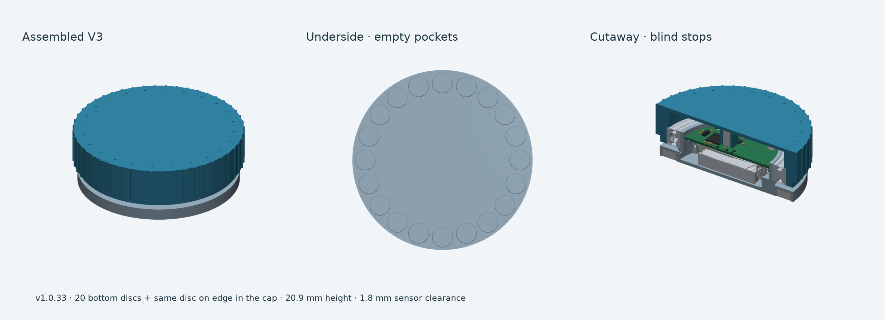

# Fidget counter — v1.0.33

V3 uses **20 circular Ø6 × 3 mm axial magnets inserted from underneath a one-piece base**. The blind pockets have integral stops and sidewall adhesive retention. The enclosure uses two PETG prints: one base and one selected cap. There is no permanent magnetic ring, steel backing or separate magnet carrier in this version.



The native circuit preview selects V3. The base remains Ø58 mm, the largest cap Ø61.6 mm and physical height **20.9 mm**. The top encoder uses the **same Ø6 × 3 mm axial disc as the base, mounted on its edge** in a keyed slot. All eleven cap styles have been updated. Keeping the 1.8 mm sensor clearance adds 4.5 mm to the cap height; the bearing, PCB, CR2450 and screw positions are retained.

[Encoder orientation](mechanical/variants/V3_disc_magnets/encoder-orientation.png) · [Full exploded view](mechanical/variants/V3_disc_magnets/exploded-v1.0.33.png) · [Print, source and assemble V3](mechanical/variants/V3_disc_magnets/README.md) · [Parts to order](mechanical/variants/V3_disc_magnets/ORDER_LIST.csv)

## Build one prototype

1. Print the V3 pocket-fit coupons, then **Base_V3_Discs and one Cap** from the V3 print manifest. Use the updated STLs under `mechanical/variants/V3_disc_magnets/generated/Print_STL/`. The root `mechanical/Print_STL` files are historical V1 parts.
2. Source **21 identical Ø6 × 3 mm axial N52 discs**: 20 for the base and one for the cap. Also source one 6808-ZZ bearing, one populated RevC PCB, one CR2450 and two M2 × 4 mm nylon screws. The PCB includes its soldered holder and JST programming connector. The [order list](mechanical/variants/V3_disc_magnets/ORDER_LIST.csv) supplies specifications and supplier examples.
3. Clean and measure the blind pockets, select a measured phone/case pole arrangement, insert and sidewall-bond the discs from the underside. Nominal disc faces sit 0.2 mm below the phone-contact face. See the [V3 assembly directions](mechanical/variants/V3_disc_magnets/README.md#pocket-dimensions-and-assembly).
4. [Build/download the RevC firmware](firmware/README.md), [program the board](PROGRAMMING.md) before fitting the cell, then follow the common board/bearing/cap steps in [ASSEMBLY.md](ASSEMBLY.md).

This remains a fit-test prototype. Removing the steel backing changes the magnetic field and holding force. The single disc row does not reproduce a concentric MagSafe pole pattern. Measure actual phone/case attachment, adhesive retention, Hall counting and BLE/current before a batch; printed push-fit bearing retention also needs qualification.

## Files to print or order

- [V3 print-test ZIP — two default product parts and fit coupons](https://github.com/rushabhcodes/fidget-counter/blob/codex/axial-encoder-1.0.33/manufacturing/fidget-counter-V3-discs-print-test-1.0.33.zip)
- [V3 complete exact CAD ZIP — STEP, GLB, all cap alternatives and source](https://github.com/rushabhcodes/fidget-counter/blob/codex/axial-encoder-1.0.33/manufacturing/fidget-counter-V3-discs-CAD-1.0.33.zip)
- [Current PCB fabrication ZIP — Gerbers, BOM and CPL](https://github.com/rushabhcodes/fidget-counter/blob/codex/axial-encoder-1.0.33/manufacturing/fidget-counter-fabrication-1.0.33.zip)
- [V3 print manifest](mechanical/variants/V3_disc_magnets/generated/print-ready-manifest.json), [mechanical BOM](mechanical/MECHANICAL_BOM.csv), [electronic BOM](BOM.csv)

The PCB fabrication payload is unchanged from corrected v1.0.31/1.0.30. Get a Standard double-sided PCBA/ENIG quote for all **27 FIT** components. Holder BT1 and J_DEBUG are already included. Application firmware is rotation-only: one complete turn either way counts once, with unfinished backtracking canceled. Firmware, the RevC board definition, BLE client and CI build remain in [firmware](firmware/README.md); use an artifact from a successful run for the intended commit.

## Rebuild and verify

Use pinned tscircuit0.0.3060/Bun, the mechanical Python requirements, VTK/Matplotlib for images and an installed PrusaSlicer CLI. For V3 the variant builder is the authoritative base and cap generator; the root enclosure parameters continue to describe the unchanged common V1 hardware.

```sh
bun install --frozen-lockfile
python mechanical/variants/V3_disc_magnets/build.py
python mechanical/variants/V3_disc_magnets/export_preview.py
python mechanical/variants/V3_disc_magnets/audit.py --slicer /path/to/prusa-slicer
python mechanical/variants/V3_disc_magnets/render.py
bun run typecheck
bun test
bun run build:source
bun run check:assembly
bun run check:programming
```

The V3 CAD audit checks 20 bottom insertion paths, blind roofs, all eleven caps through full rotation, 27 actual supplier bodies and unchanged upper interfaces. The native preview check requires all routed PCB records and fitted electronic records to equal frozen corrected v1.0.31. Print audits check actual toolpaths; they do not qualify a particular printer, magnet bond or attachment force.

[V1 premade ring](mechanical/variants/V1_premade_ring/README.md) and [V2 rectangular magnets with steel/carrier](mechanical/variants/V2_discrete_magnets/README.md) are preserved historical alternatives. Use each version's complete matching parts. Their old audit reports describe those versions, not V3. [Mechanical background](MECHANICAL.md), [assembly](ASSEMBLY.md), [programming](PROGRAMMING.md) and [PCB review](validation/FABRICATION_REVIEW.md) retain the common hardware evidence.
