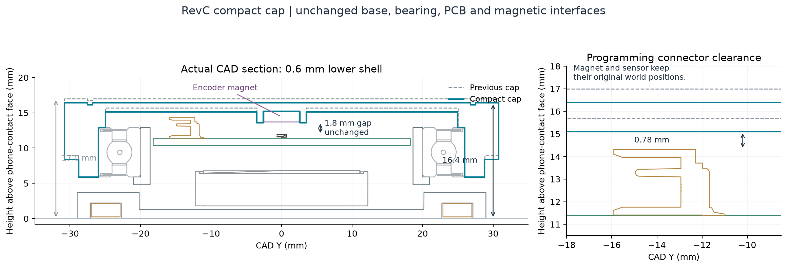

# Compact cap for the RevC pilot

The current cap reduces phone-contact height from17.0 to16.4mm (0.6mm, approximately3.5%). The base, PCB/CR2450 holder,6808 bearing, two PCB screws, attachment ring and encoder magnet retain their established positions and interfaces. A unit still has two printed parts and nine handled parts. All eleven cap styles retain the8mm grip height; their exterior grip profile moves0.6mm down.

| Dimension | Previous push-fit cap | Compact cap |
| --- | ---: | ---: |
| Top datum above CAD zero |17.2mm|16.6mm|
| Phone-contact face to top |17.0mm|16.4mm|
| Main underside roof datum |15.9mm|15.3mm|
| Nominal main deck |1.3mm|1.3mm|
| Local roof above encoder magnet |1.8mm|1.2mm|
| Conservative full-rotation JST gap |1.38mm|0.78mm|
| Bearing and encoder interfaces |40.05/51.95mm fit; magnet stop Z15.4|Unchanged|

The top-mounted programming header is2.92mm above the PCB in the conservative courtyard, reaching Z14.52. Its actual supplier STEP reaches Z14.511. The cap must clear the entire annulus swept by this connector during rotation. The compact underside at Z15.3 retains0.78mm nominal clearance, above the existing0.7mm design minimum. That is a digital clearance, not a measured tolerance stack on a printed unit.

The encoder remains at Z13.9–15.4, preserving its1.8mm relative sensor gap. The lower cap cuts its magnet pocket after the exterior-grip union so that the union cannot refill the pocket. The local1.2mm roof is eight0.15mm layers before slicing effects. Existing thumb dishes retain their0.9mm local minimum; the main untextured deck is1.3mm. No wall/fit is scaled to obtain the reduction.

Lowering this same1.3mm deck by1.0mm would leave only0.38mm JST clearance and0.8mm encoder roof. Those fail the retained0.7mm connector and1.2mm local-roof limits. Further reduction needs a different component stack or additional roof-strength qualification; it is not justified by apparent empty space alone.



## Validation

The reference is the digitally checked push-fit CAD at b300e196ec7e3ff56dc7dc9638462b9cf52ab772. The compact validator compares each entire finished cap against a translated former solid, restoring only the established bearing plane and fixed encoder pocket. It rejects unexplained material changes, changed parameters, base modifications and encoder-stop cuts. It also checks each closed STEP/STL, unchanged XY envelopes and full swept connector clearance. The CAD builder independently checks all27 supplier STEP electronics, the cell, bearing races and24 sampled rotor angles, with axisymmetric interfaces providing the continuous-rotation argument.

Use the current validation/compact-cap-audit.json, pushfit-cad-audit.json, encoder-gap-audit.json, jst-connector-clearance.json and print-readiness.json for measured digital results. Rebuild with:

```sh
python mechanical/build_enclosure.py --style all --assembly-style circular
python validation/check-pushfit-cad.py
python mechanical/printing/audit_prints.py --slicer /path/to/prusa-slicer
python mechanical/printing/check_wall_sections.py
python mechanical/export_circuit_models.py
bun run build:source
```

Print one circular prototype and calibrate the bearing coupons first. Inspect roof continuity, support removal, warp, bearing seating and real connector clearance. Existing pull-off/creep/service, adhesive, loaded holder, magnetic/count, RF/current and firmware hardware-acceptance gates remain open. There is still no positive axial lock. This change has not been physically printed or manufactured.
