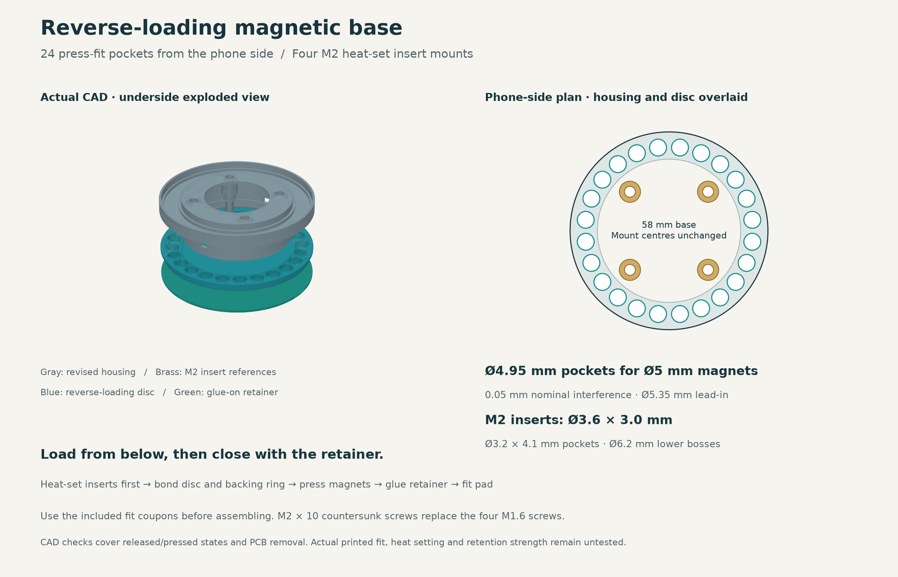

# Reverse-loading magnetic base and M2 insert mounts

This mechanical revision fits the **58 mm, revision 1.0.7 enclosure** in this project. It replaces the magnet disc, stationary housing and flexure, and uses the existing glue-on retainer as the required closing plate. The PCB, mounting-hole positions, rotating cap, four PCB bushings, steel backing ring and service tools are reused. The original baseline CAD and published circuit are retained separately; use the files in this revision's `export/` for the new base.



## What changed

- **Magnets load from the phone-facing underside**, opposite to the original inside-face loading. Press them toward the steel backing ring, which provides the seating stop, then glue on the retainer to close the loading face.
- The 24 Ø5 × 1.5 mm attachment magnets use **Ø4.95 mm straight pockets**, a nominal 0.05 mm diametral interference instead of the old 0.25 mm clearance. Each opening has a **0.20 mm × 45° lead-in**, Ø5.35 mm at the mouth. This is a trial press fit; actual interference depends on the print and magnet tolerances.
- The four mounting locations now use **M2 heat-set inserts and M2 × 10 countersunk screws**. Inserts load from the underside before the magnetic disc is bonded. Enlarged lower bosses taper back to the existing PCB shoulders below the rotating skirt, so the PCB holes and spacer bushings remain unchanged.
- The flexure has enlarged mounting pads, **Ø2.2 mm clearance holes and Ø4.0 mm countersinks**. Use **Ø3.8 mm, 90° countersunk heads** and check seating before tightening. The CAD reference represents the cone above the Ø2 mm shank; a stock screw's quoted total head height can also include its narrower neck.

The revised disc has open magnet holes, so **the retainer is required**. The 0.60 mm retainer and nominal 0.05 mm glue layer make the assembly **14.65 mm high**, including the relocated 0.20 mm protective pad. Magnet faces seat at Z0.90–2.40; the backing ring remains at Z2.40–3.10. Check actual phone holding force after assembly.

## Selected insert and mounting dimensions

The reference insert is **CNC Kitchen M2 × 3**: M2 internal thread, **3.6 mm maximum outside diameter, 3.0 mm length**. Its manufacturer specifies a **3.2 mm installation hole**, at least **1.3 mm wall**, and a blind hole at least **1 mm deeper than the insert**. These figures come from the [manufacturer's dimension and design guide](https://cnckitchen.com/s/CNCKitchen_Heat-Set-Insert-Dimensions-and-Design-Guidelines.pdf).

| Feature | This design |
|---|---|
| Insert pockets | Four, Ø3.20 × 4.10 mm deep, open on the housing underside |
| Insert position | Face recessed 0.10 mm from the housing underside; nominal Z0.90–3.90 |
| Plastic relief beyond insert | 1.00 mm |
| Lower boss diameter | 6.20 mm; 1.30 mm radial wall around the nominal Ø3.6 mm knurled envelope |
| Mount centres | Unchanged: (±11.45513, ±11.45513) mm |
| Screw through-hole | Ø2.20 mm |
| Screws | Four M2 × 10 countersunk; 10 mm **overall including the head** |
| Nominal thread engagement | 2.30 mm in the insert, with the reference head seated 0.10 mm below the flexure surface |
| Screw tip clearance above centre floor | 0.80 mm |

An example screw matching the selected diameter, length and angle is [Accu SIK-M2-10-A2, M2 × 10 DIN 965H](https://www.accu.co.uk/phillips-countersunk-screws/65889-SIK-M2-10-A2): Ø3.8 mm head, 90° countersink and PH0 drive. Its listed total head height is 1.2 mm; the lower neck lies within the clearance bore. The CAD's simplified 0.9 mm cone above the nominal Ø2 mm shank is a clearance envelope, not a claim that the complete purchased head is 0.9 mm high. Check the actual screw profile and seating against the print.

M2 is the thread size, not the insert body diameter. Use the specified compact insert or adjust `parameters.json` for the actual manufacturer's dimensions. A longer M2 insert is not a drop-in substitute. The insert STEP shapes are simple knurl envelopes for fit checking, not manufactured threads or printable hardware.

## Print list

[Download the complete print pack](export/Base_Rev2_Print_Pack.zip), including the revised parts, fit coupons, reused cap/bushings/tools, editable revised STEP solids, reference assemblies and validation report.

Print one of each revised part from `export/Print_STL/`:

| Part | File |
|---|---|
| Magnetic base disc with reverse-loading press-fit holes | [Magnetic_Base_Disc_Reverse_Load.stl](export/Print_STL/Magnetic_Base_Disc_Reverse_Load.stl) |
| Stationary housing with M2 insert pockets | [Stationary_Housing_M2_Inserts.stl](export/Print_STL/Stationary_Housing_M2_Inserts.stl) |
| Flexure with M2 clearance and countersinks | [Flexure_Retention_System_M2.stl](export/Print_STL/Flexure_Retention_System_M2.stl) |
| Closing retainer, Ø58 × 0.60 mm | [Magnet_Retainer_58mm.stl](export/Print_STL/Magnet_Retainer_58mm.stl) |

Reuse the matching original [rotating cap](../Print_STL/Rotating_Cap.stl), four [PCB bushings](../Print_STL/PCB_Spacer_Print_4.stl), two [release keys](../Print_STL/Cap_Release_Key_Print_2.stl) and one [PCB lift pick](../Print_STL/PCB_Lift_Pick.stl). Use PETG for the cap/flexure and a suitable thermoplastic for the heat-set housing. Fit-test the actual material and print settings; heat-setting strength is untested. The silicone ring, PET shims and steel ring remain separate material parts.

STLs are already on Z=0. Keep the disc in its supplied orientation, phone-side mouths toward the bed, with the raised locating ring upward. The lead-in helps relieve the entry edge; avoid first-layer flare closing the pockets. The retainer prints flat at 0.20 mm layer height and 100% solid, three layers total. Check the housing's underside holes for support residue before heat-setting.

Print the coupons first, using the final material, orientation and settings:

- [Magnet fit coupon](export/Print_STL/Magnet_Fit_Coupon_4p90_4p95_5p00_5p05.stl): four through pockets, **4.90 / 4.95 / 5.00 / 5.05 mm**, ordered from the notched end. The loading mouths are on the bed face, matching the disc. Choose a gentle supported press fit, measure the result and change `magnet_pocket_diameter` before regenerating if needed.
- [M2 insert fit coupon](export/Print_STL/M2_Insert_Fit_Coupon_3p10_3p20_3p30.stl): three blind pockets, **3.10 / 3.20 / 3.30 mm**, ordered from the notched end. Confirm a straight, recessed insert installation and that a screw can be tightened without the insert turning or pulling out.

The diameter options are calibration samples, not promised fits. Do not force a magnet into an overly tight pocket; select a larger coupon size and regenerate instead.

## Assembly order

1. Print and test the coupons. Dry-fit the revised housing, disc and flexure with the existing PCB and cap.
2. With the magnetic disc off, heat-set the four M2 inserts **from the underside of the housing**, following the insert supplier's installation directions. Keep their faces 0.10 mm recessed. Let the plastic cool before installing screws or magnets. Check thread access and boss condition.
3. Fit the existing steel backing ring into the housing recess. Bond it so it remains seated while loading the magnets; allow the adhesive to cure. Dry-fit the empty revised disc and verify that the backing ring is the magnet stop.
4. Bond the empty disc to the housing mating faces. Keep adhesive out of the press-fit bores and moving clearances. The magnet loading holes must remain accessible from the phone-facing side.
5. Check the polarity/attraction of all 24 axial magnets against the intended phone or case. Support the assembly and press each magnet through its lead-in toward the steel stop using a controlled, even load. The seated magnets are recessed from the loading face; keep them seated while closing the base.
6. Bond the retainer to the rigid plastic lands around and between the holes. The retainer must bond to the disc, not only to the magnets. Keep the plate flat and centred; allow the adhesive's full specified cure. Fit the protective pad below it.
7. Refit the PCB on its existing shoulders, the four 2.5 mm bushings and the revised M2 flexure. Fit four M2 × 10 countersunk screws with compatible head dimensions. Check screw seating and tip clearance; tighten gently into the brass threads. Adjust the silicone/PET actuator stack as described in [REVIEW_FIXES.md](../../REVIEW_FIXES.md#press-assembly-and-tolerance-budget), then refit the cap.
8. Confirm full rotation, press/return travel, top battery service, and repeated phone attachment/removal over a soft surface. Check the plate bond, insert retention and phone holding force before relying on them.

The **central encoder magnet stays diametrically magnetized** and loads into the cap as before. This revision reverses only the 24 axial attachment magnets in the base.

## CAD, checks and regeneration

`export/STEP_Parts/` contains editable solids for every revised print. `Assembly_Released.step` and `Assembly_Pressed.step` show the complete mechanical assembly with electronics envelopes, M2 insert/screw reference shapes and the required retainer. They are mechanical references, not PCB fabrication exports. `Validation/geometry-checks.json` records:

- one valid solid and a watertight, consistently oriented STL mesh per printed part;
- unintended interference in both press states, with nominal magnet press fit, insert knurl displacement and the original battery spring overlap reported separately;
- clear phone-side loading paths for all 24 magnets and full coverage by the retainer;
- insert wall/relief, nominal screw engagement and tip clearance;
- nine PCB extraction positions with the new housing and inserts installed.

With Python containing CadQuery ≥2.6, trimesh, numpy and matplotlib, run from the project root:

```sh
python mechanical/base-rev2/generate.py
python mechanical/base-rev2/package.py
```

The generator executes the original parametric enclosure's modeling section in a temporary directory, then derives and checks the revised parts from the same exact released/pressed geometry. It skips the original assembly export loop and writes this revision's own exports. Change `parameters.json` to tune the trial magnet fit. Actual print fit, heat installation, flexure force/fatigue, thread retention and phone pull-off strength still require a physical prototype.
