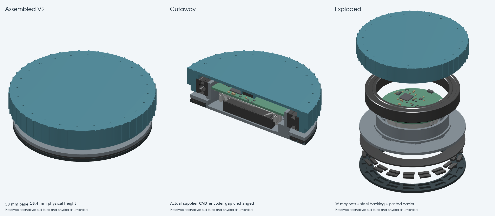

# V2 — individual-magnet base alternative

**Experimental replacement base, ready for a fit-test print after the recorded slicer check. Comparable holding force is a test target, not a measured result.** [V1](../V1_premade_ring/README.md) is preserved byte-for-byte as the fallback. The main circuit viewer and existing `mechanical/Print_STL` set still show V1, so existing qualified software checks retain their meaning; use this folder's explicitly named V2 files for the new base. Do not mix the V1 base with the V2 carrier. Neither version is physically production-qualified.

V2 uses a redesigned base, a printed magnet carrier, **36 separate 6 × 2 × 1 mm axial magnets** in two circular rows, and one custom-cut steel backing. The existing cap, encoder magnet, bearing, PCB, cell and two PCB screws are retained. This is independent CAD inspired by the reference magnetic arrangement, not a certified MagSafe assembly.

| Feature | V1 premade ring | V2 discrete magnets |
| --- | --- | --- |
| Physical height / base diameter | 16.4 / 58 mm | **16.4 / 58 mm** |
| Nominal encoder magnet–sensor gap | 1.8 mm | **1.8 mm, unchanged** |
| Attachment magnet phone setback | 0.2 mm | 0.3 mm, behind the carrier skin |
| Rigid printed product parts | 2 | 3: base, carrier and one existing cap |
| Handled parts, PCBA counted as one | 9 | 46, excluding adhesive and tools |
| Attachment assembly | Bond one supplied ring | Bond 36 magnets, backing and carrier |
| Normal holding force | Not measured | Target within ±10% of measured V1 |

The extra carrier allows all magnets to be loaded from above and then closed by the backing. An integral base with blind individual pockets would obstruct insertion of a continuous steel backing. The carrier removes that assembly trap and avoids fragile snap tabs. It bonds into the base; replacement requires adhesive rework and is not a tool-free service operation. The active encoder magnet remains a separate **diametrically magnetized Ø5 × 1.5 mm** part.

## Buy or fabricate separately

Prices checked 2026-11-03 UTC; quantities, taxes, freight and supplier tolerances must be confirmed before buying. No order has been placed.

| Item | Per unit | Source and specification |
| --- | ---: | --- |
| Small magnets | 36 | [SuperMagnetMan M0601](https://supermagnetman.com/products/m0601), **6 × 2 × 1 mm, N50, nickel, magnetized through 1 mm**. Listed $0.65 each, MOQ20, stock2430 at research time: $23.40 magnets per device before shipping/tax. [Supplier FAQ](https://supermagnetman.com/pages/faq-new) confirms an Alabama warehouse and domestic shipping. Their stated limit is60°C. The 0.15 mm clearance per side is a pilot allowance, not a confirmed supplier tolerance. |
| Steel backing | 1 | **OD57.6 / ID43.0 / finished thickness0.762 mm**; see supplied STEP and DXF. Custom cut from low-carbon1008/1010 steel, deburr and protect against corrosion. [Artus](https://artusworld.com/product/10-sheet-steel-shim-stock/) offers1010 shim stock including0.030-inch thickness. Its page is a raw-stock source, **not** a ready-cut ring or a certified magnetic shield. Request/certify magnetic properties before production; no supplier was contacted. |
| Dimensionally compatible alternative | 36 if substituted | [AMF22071](https://amfmagnets.com/products/neodymium-block-magnet-6mm-x-2mm-x-1mm-n52), same6 × 2 × 1 mm geometry, axial N52. Listed $0.25 each at1–99. US dispatch and batch tolerance are unverified. Higher grade does not establish phone holding force; repeat the full qualification if substituted. Do not substitute a6 × 3 mm inventory magnet. |

36 magnets cost more and require more handling than the previous premade ring. Use V1 if price or assembly throughput takes priority. A factory-made discrete array/carrier may be a later volume option, subject to quotes and physical tests.

## Polarity and assembly

1. Print `generated/Print_STL/Base_V2_Discrete.stl` and `Magnet_Carrier_V2.stl`, plus **one** existing `mechanical/Print_STL/Cap_*.stl`. Keep the established PETG bearing-fit coupons and cap-specific support instructions. The base needs the supplied fixed-base supports; remove them completely from the roof/bonding surface before assembly. Print the carrier phone-face down **without supports**, using a0.15 mm first layer and0.15 mm subsequent layers so its0.3 mm floor is two layers. **Do not print the magnets or steel reference parts.**
2. Dry-fit the empty carrier. Its inside diameter42.6 mm locates over the base's42.3 mm register with0.15 mm radial clearance. It seats flush at the same phone-contact plane as V1. Verify the actual purchased magnet batch fits the6.3 × 2.3 mm pockets without force.
3. Place the carrier phone-contact face down. Identify poles with a known pole indicator. On the **phone-facing underside**, all18 inner magnets expose **S**, and all18 outer magnets expose **N**. From the top/loading side, those labels reverse: innerN, outerS. Do not alternate poles around either circumference. Use [polarity.svg](polarity.svg); ordinary unmarked nickel magnets are not color-coded.
4. Seat each magnet against its **dry pocket floor** and bond its **sidewalls** using a compatible nonconductive adhesive in the0.15 mm side clearance. Do not put an adhesive layer beneath the magnet: that would lift it and consume the backing bond gap. Keep glue and burrs off the height stops. Magnet faces lie atZ0.5–1.5; the0.3 mm carrier floor protects the phone. **Cure the magnet-to-carrier bonds before bringing in the steel**, so attraction cannot lift the magnets out of their seats. The nominal magnet-to-steel adhesive gap is0.05 mm.
5. Deburr, clean and flat-check the steel backing. Seat it on the carrier webs atZ1.55–2.312 and bond through the0.05 mm gaps above the magnets. The carrier webs are dry height stops: do not add an extra adhesive layer on their tops. No PETG layer belongs between magnet faces and steel. Keep the assembly flat while curing, and verify polarity and seating. The steel closes the rear flux path; it is not an extra permanent magnet.
6. Bond the complete magnetic carrier/backing assembly into the V2 base. The steel-to-base ceiling gap is nominally0.088 mm. The base recess ends atZ2.4. Actual steel finish, flatness and adhesive thickness must fit this stack; reject a proud carrier or a warped base. **Do not omit the backing and assume the same force.**
7. Program and assemble the unchanged electronics, cell, bearing and cap using [ASSEMBLY.md](../../../ASSEMBLY.md). Retain the two PCB screws. Let adhesive cure fully before mounting to a phone or doing a pull test. No assembly-time measurement has been made.

## Reference and force acceptance

[Apple's Accessory Design Guidelines](https://developer.apple.com/accessories/Accessory-Design-Guidelines.pdf), 2026-10-30, §41.2 and figures41-7/41-8, show opposite inner/outer phone-facing poles and low-carbon steel backing. The specified accessory magnet material isN48H; N52 is not a universal MagSafe requirement. Our stock rectangular N50 geometry, pole widths, segmentation, cover setback and backing differ, so the reference does **not** certify this design or predict its force. Supplier pull-to-steel figures cannot be summed to get pull-to-phone force.

Measure V1 and V2 on the **same phone and case**, with identical cleaned surfaces, temperature, centering and cured adhesive. Clamp the accessory and pull the phone normal to its back with a digital peak-force gauge and a nonmagnetic fixture. Correct for phone/fixture weight. Run at least five pulls per version and record each value, mean and spread. Acceptance target: V2 mean within±10% of V1, no partial detachments or damaged adhesive, and at least V1's resistance to slip under the same measured rotation torque. Test each intended phone/case, including the thickest case. Record before/after repeated use and warm storage; reject peel, magnet movement, PETG creep or surface damage. Apple separately lists650–1510 gf for its accessory force criterion; meeting our comparative target alone does not establish compliance.

Before any production order, verify actual magnetic material/finish/tolerance, steel magnetic saturation properties, normal pull and tangential slip, adhesive aging, fall/impact retention, phone compatibility, Hall angle/counting accuracy in all orientations, nearby battery/bearing effects, and assembled BLE range/current. A stronger attachment field may disturb the encoder even though its1.8 mm gap is unchanged. Keep small magnets contained throughout handling and after enclosure damage.

## Regenerate and verify

From the repository root with the mechanical requirements installed:

```sh
python mechanical/variants/V2_discrete_magnets/build.py
python mechanical/variants/V2_discrete_magnets/audit.py --slicer /path/to/prusa-slicer
python mechanical/variants/V2_discrete_magnets/check_assembly_steps.py
python mechanical/variants/V2_discrete_magnets/render.py
```

The V2 builder refuses changed V1 files, PCB bytes, supplier STEP models or cap STEP files. Its audit bounds all V2 base changes to the underside recess and checks exact solids, closed meshes, pocket walls, floor, 27 actual supplier bodies, cell clearance and all11 caps. The slicer uses a provisional PETG0.4 mm nozzle /0.15 mm layer profile on a generic220 mm bed. Re-slice for the actual printer. Audit G-code is not a deliverable or a safe machine profile.

`generated/Assemblies` contains full exact assembled/exploded STEP references; `generated/V2_assembled.glb` is the standalone mesh view of the new alternative. See the actual CAD review below. The main tsCircuit electrical viewer deliberately retains the V1 mechanical reference until the force comparison qualifies V2.

The published site also provides **`/v2/`**, a separate V2 CAD review page with the actual render, polarity diagram and downloadable full assembly GLB. The print-test and complete STEP/DXF archives are linked there. No export cache or existing assembled STEP is needed to rebuild V2: it uses the frozen V1 hardware source, checked cap files and supplier STEP bodies already in this checkout.


