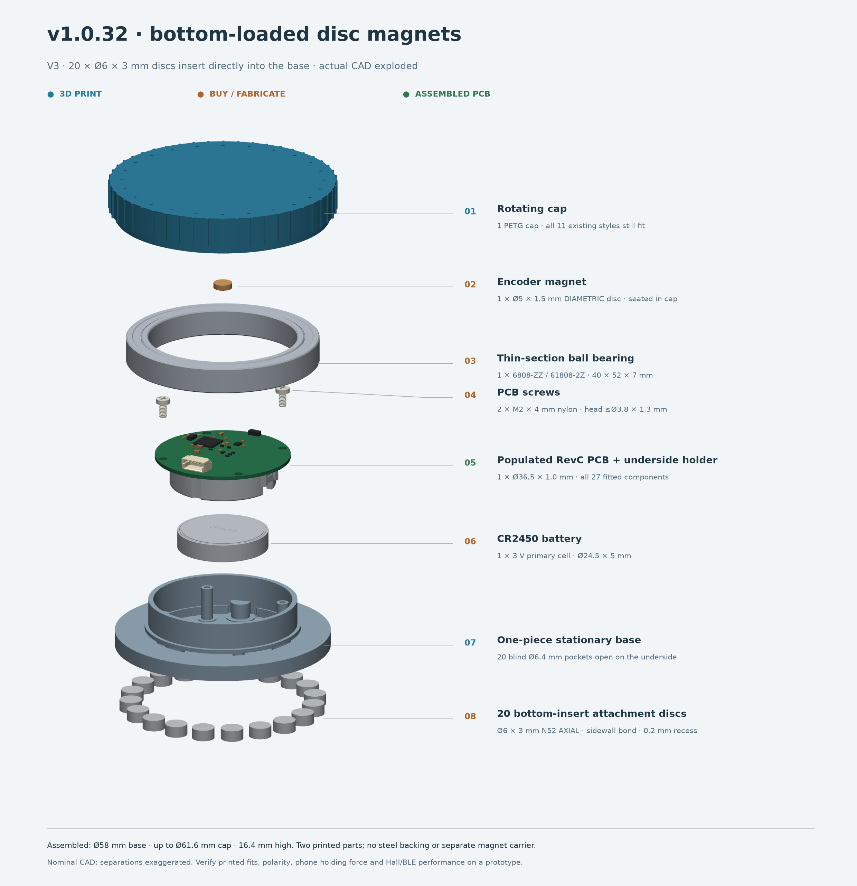

# v1.0.32 — bottom-insert Ø6 × 3 mm disc magnets

Twenty circular **Ø6 × 3 mm axial N52 magnets** insert from the phone-facing underside into blind pockets in a **one-piece PETG base**. Sidewall adhesive retains them against integral stops. The enclosure has two printed product parts: base and one cap. There is **no steel backing, premade magnetic ring or separate carrier** in V3.



The base stays Ø58 mm and the physical height stays **16.4 mm**. The 6808-ZZ bearing, all eleven cap styles, RevC PCB/CR2450 and two nylon PCB screws are retained. The separate **Ø5 × 1.5 mm diametric encoder magnet** remains in the cap with a 1.8 mm sensor gap. One device has 28 handled parts, excluding adhesive/tools; an assembled PCBA counts as one.

## Print and buy

Print one `generated/Print_STL/Base_V3_Discs.stl` and one unchanged `mechanical/Print_STL/Cap_*.stl`. The default kit supplies the circular cap. Print the pocket-fit coupons first. Follow the [print manifest](generated/print-ready-manifest.json), existing cap support profiles and the provisional PETG / 0.4 mm nozzle / 0.15 mm layer process. The base needs fixed-base supports; clear them fully from every bottom pocket and blind stop. V1/V2 bases and carriers are incompatible with V3.

| Purchase | Per device | Required specification and supplier example |
| --- | ---: | --- |
| Attachment magnets | 20 | **Ø6 × 3 mm, axial, N52, nickel coated**. [Patel Magnets — select N52](https://patelmagnets.com/shop/6-x-3mm-neodymium-magnets/) or [JC JCN52-DSC6-3](https://www.jc-magnetics.com/Magnet-Discs/Magnet-N52-6mm-3mm-Discs). JC lists a 25-piece minimum, allowing five spares for one prototype. |
| Thin-section bearing | 1 | **6808-ZZ / 61808-2Z, 40 × 52 × 7 mm**. [Bearing House example](https://bearinghouse.in/shop/ntn-6808zz-deep-groove-ball-bearings/). |
| Populated RevC PCB | 1 | Ø36.5 × 1 mm, all **27 FIT components** from [BOM.csv](../../../BOM.csv), including the soldered CR2450 holder and JST header. [JLCPCB assembly quote](https://jlcpcb.com/pcb-assembly); use the v1.0.32 fabrication bundle. |
| CR2450 | 1 | Loose 3 V primary lithium cell, Ø24.5 × 5 mm. [Panasonic example](https://www.panasonic.com/in/consumer/battery/specialty-batteries/lithium-coin/cr-2450-5be.html). |
| Encoder magnet | 1 per cap | **Ø5 × 1.5 mm, diametrically magnetized**. [Exact-size example](https://www.buyneomagnets.com/p/5mm-x-1-5mm-diametrically-magnetized-neodymium-disc-magnet-n38-rare-earth-diametric-magnets-50-pack/). |
| PCB screws | 2 | M2 × 4 mm nylon; head at most Ø3.8 × 1.3 mm. [DIN85 example](https://www.vital-parts.co.uk/slotted-pan-head-nylon-screws-din-85/42809-sph85-m2-4-ny-n). |
| Adhesive / PETG | Shared pack | Qualify nonconductive sidewall adhesive for PETG and the nickel coating. A print service can supply PETG. |

[ORDER_LIST.csv](ORDER_LIST.csv) includes these items and shared programming equipment. The two attachment-magnet suppliers' size, axial polarization and N52 option were reviewed on 12 November 2026. Stock, shipping and batch tolerances remain supplier checks. JC publishes conflicting ±0.05 and ±0.1 mm tolerances; the CAD uses **±0.1 mm** in diameter and thickness. Do not order the 6 × 3 mm diametric variant for attachment. The encoder requires its own smaller diametric disc.

## Pocket dimensions and assembly

The phone-contact face is Z0.2 mm. The 20 centers sit at R24.85 mm, 18° apart. Pockets are Ø6.4 mm, with a Ø6.6 mm × 0.2 mm entry chamfer. Nominal cylindrical radial clearance is 0.2 mm; a maximum Ø6.1 mm disc leaves 0.15 mm. Pocket webs are 1.375 mm, cylindrical radial walls 0.95 mm and minimum entry walls 0.85 mm.

Each blind stop is at Z3.4 mm. A nominal 3 mm disc seated against that stop ends at Z0.4, **0.2 mm recessed** from the phone-contact face. A 3.1 mm maximum-thickness disc remains 0.1 mm recessed, before printer variation. The solid roof is 1 mm thick, ending at Z4.4; the bearing starts at Z6.1. Every upper interface is unchanged above Z4.4, and all eleven caps clear the new base through full rotation.

1. Print the 6.3/6.4/6.5 mm pocket coupons, then the base and one circular cap. Remove support remnants and measure the purchased magnets and actual pockets. The production pocket is Ø6.4; coupons diagnose printer fit. Do not force a disc.
2. Identify poles with a pole indicator and dry-test the intended phone/case in a removable fixture. Record a measured pole arrangement in `polarity-map.csv` **before bonding**. Pocket numbers are counterclockwise from +X when viewed from the top; their order appears reversed from underneath.
3. Turn the base over. Apply compatible adhesive to a pocket sidewall, keep its blind stop dry, and insert the disc **from the underside** until it seats. No adhesive layer goes above the disc because that would reduce the phone-face recess. Confirm every face is recessed and no glue remains on the phone-contact rim. Repeat for all 20 and let the adhesive fully cure. Adhesive is the retention method; no hidden backing or snap lip holds a loose disc.
4. Program the board before closing the enclosure, fit the CR2450 and two opposite nylon screws, then the bearing and cap. Follow the common electronic/bearing steps in [ASSEMBLY.md](../../../ASSEMBLY.md) and [PROGRAMMING.md](../../../PROGRAMMING.md). Select 3V3 and remove the cell before powered programming.

Removing steel changes the flux path and can reduce attachment force or increase stray field at the encoder. One row of axial discs also differs from the former opposite inner/outer radial pole pattern. No universal pole assignment, MagSafe compatibility or phone pull force is established by CAD. Measure pull/slip, magnet bond retention, Hall counting and BLE/current with the intended phone/case and cured assembly before a batch. Printed bearing retention and fit remain prototype tests.

## Deliverables and checks

[Print-test ZIP](../../../manufacturing/fidget-counter-V3-discs-print-test-1.0.32.zip) · [Full CAD ZIP](../../../manufacturing/fidget-counter-V3-discs-CAD-1.0.32.zip) · [Assembled/cutaway/underside views](review.png) · [Assembled GLB](generated/V3_assembled.glb) · [Exploded GLB](generated/V3_exploded.glb).

The print kit contains exactly two default product STLs, fit coupons, profiles and instructions. The CAD kit adds exact assembled/exploded STEP, GLB, all cap alternatives, source and audit evidence. Reference magnet STEP/GLB files are purchased-part illustrations, not print parts.

```sh
python mechanical/variants/V3_disc_magnets/build.py
python mechanical/variants/V3_disc_magnets/export_preview.py
python mechanical/variants/V3_disc_magnets/audit.py --slicer /path/to/prusa-slicer
python mechanical/variants/V3_disc_magnets/render.py
bun run typecheck
bun run build:source
bun run check:assembly
bun run check:programming
```

Use `mechanical/requirements.txt`; rendering additionally uses VTK and Matplotlib. The audits check bottom insertion at seven poses for every disc, blind stops/roofs, actual supplier bodies, all eleven caps at 24 angles, STEP/GLB poses and actual slicer output. Native preview validation requires every routed PCB record and all 27 fitted electronic records to match frozen corrected v1.0.31. V1/V2 stay preserved in their own folders. Physical fit and magnetic performance are unverified.
