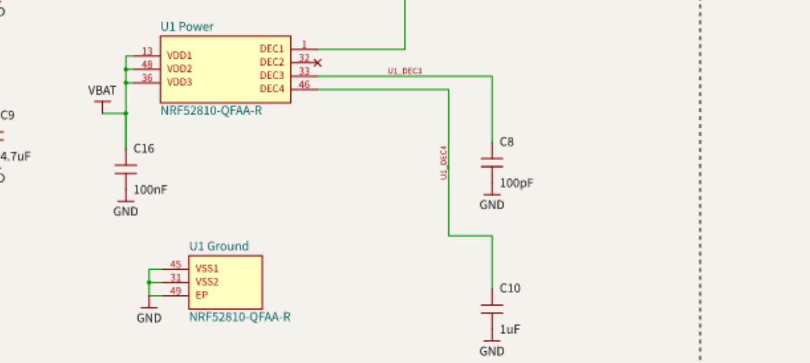

# Electrical review resolution — 1.0.30

The supplied AI review identified real errors in 1.0.29. **Use the corrected 1.0.30 fabrication bundle; do not order the 1.0.29 PCB files.** The correction supports a controlled first article, not a production-qualified batch.

| Finding | Resolution | Status |
| --- | --- | --- |
| DEC2/pin32 had100 pF; DEC3/pin33 had100 nF | Remove C7 and its DEC2 trace/lands. Mark DEC2 unconnected in the actual pin model. C8 is now100 pF C0G, Murata GRM1555C1H101JA01D / JLC C77177, on DEC3. Regenerate BOM, CPL and fabrication files. | Corrected digitally |
| C3 returned directly to the general ground pour | Move C3 beside U1. A dedicated0.18 mm top trace returns through the VSS31 land; no via is on that return. Exclude both pours from the local region. Independent shape checks reject pour contact, another ground branch or a via bypass. | Corrected digitally; RF response still needs measurement |
| Functional schematic boxes showed local ordinals | Keep the functional boxes and display actual QFAA package pin numbers throughout, including DEC3=33, DEC2=32, ANT=30 and VSS=31/45/49. Check each displayed number against its physical source port. | Corrected digitally |
| RF feed and final assembly performance unverified | The0.5 mm, zero-via RF feed is retained. Its width alone does not establish50 Ω; it is approximately17.9 mm long and has adjacent ground and a modified antenna environment. | Physical/fabricator release gate remains open |
| Bearing relies on interference fits without an axial lock | Keep the existing calibrated coupon set and unchanged two-part16.4 mm enclosure. Printed pull-off/drag/service/creep performance cannot be established from nominal0.05 mm interference or a mesh check. | Physical release gate remains open |

## Manufacturer evidence

Nordic's [nRF52810 Product Specification v1.3](https://datasheet.lcsc.com/datasheet/pdf/8aa971f7927db652602461b49c88d682.pdf?productCode=C141828), document 4430_161, was retrieved from LCSC and its pages 396 and 405 were visually inspected. Section 7.3.1 shows DEC2 unconnected and100 pF on DEC3 for QFAA LDO operation. Section 7.3.9 states: “It is not directly connected to the ground plane, but grounded via VSS pin 31.” The PDF identity/hash and retrieval limitations are recorded in [nordic-reference-evidence.json](nordic-reference-evidence.json).

This implementation follows that documented topology. It does not claim an exact copy of Nordic's qualified reference artwork, nor RF qualification of the modified board. The official reference-layout ZIP was listed on Nordic's product page, but its download host was denied by the execution environment; the native reference CAD was not downloaded.

## Bounded change and verification

The electrical correction is compared with commit c9d97fc90c887e0ec1b8b791a12053a8644d82ad. Fitted quantity falls 28→27. Only C3 and C8 change placement/model records; all other 25 fitted parts keep their identities, lands, layers and poses. Only the former C7 connections disappear from the component-pin net partition. DEC2's physical pin attributes change intentionally; other electrical pin attributes remain guarded.

The denser local arrangement needs two adjusted crystal paths and one moved C8 ground endpoint. Two new ground stitches connect the surrounding GND regions without bypassing the isolated C3 return. Two ground stitches provide explicit local returns outside the RF isolation. Native export fragmentation also produced false opens: the adapter reconstructs connected fill contours with every hole retained, without refilling copper. Independent source/native parity is checked at the 1 nm native coordinate precision; real copper removal and wrong-net shorts are rejected. The final routing has69 traces and37 vias. The fixed routing contract still fails on unapproved copper, terminal, connectivity, layer, location or mask changes.

Run `bun test`, `bun validation/check-fresh-routing.mjs`, `python validation/check-nordic-rf.py`, `bun validation/check-source-snapshot.mjs`, `bun validation/run-fabrication-review.mjs`, and `python validation/check-gerber-parity.py`. Current audit JSON files bind results to source/output hashes. The exported native and Gerber copper must match the source; a compiler pass alone is insufficient. Firmware host tests include the C counter/sensor logic with address/undefined-behavior sanitizers and 14 Python programming/client tests.

## Remaining physical release gates

1. Obtain the fabricator's actual1.0 mm two-layer dielectric/copper stackup, including dielectric thickness, Dk at 2.4 GHz and finished copper. Solve the actual grounded coplanar RF feed, including adjacent ground spacing and discontinuities, against a50 Ω target. A generic FR4 calculation is insufficient to sign off the current artwork. Revise the layout and regenerate/check outputs if the approved solution requires it.
2. Tune matching on a populated first article using a VNA and suitable test fixture. Measure BLE range and harmonic/radiated performance in the complete assembly with the steel bearing, magnetic ring, cell, intended phone and case. The reference component values and L2±5% remain starting values.
3. Define acceptance loads and torque before testing. Measure bearing seating/pull-off force and rotational drag on actual PETG parts and coupons, then repeat after servicing, dwell/creep at the intended temperature and drop/handling trials. Confirm contact is on the correct races. If retention and service targets cannot both pass, use positive retention and revalidate the redesign before a batch.
4. Complete actual flashing, counting/magnetic interference, oscillator, holder/contact/polarity, current/runtime, screw and adhesive acceptance in ASSEMBLY.md. Record measured results and assembly time; digital checks do not close these gates.

